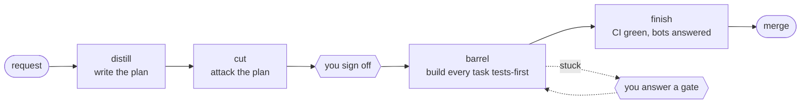

# brewery

**Turn a one-line request into a merge-ready, CI-green pull request, asking you only what matters.**
brewery is a set of agent skills (for Claude Code, Cursor, and Codex) plus a `brewery` CLI
that runs every step as its own agent process.



```bash
git clone https://github.com/joshgachnang/brewery ~/src/brewery && ~/src/brewery/bin/install
mkdir -p ~/.config/brewery && echo '{"notify":{"ntfyUrl":"https://ntfy.sh/<your-topic>"}}' > ~/.config/brewery/config.json
cd ~/src/your-repo && brewery pour "add a --json flag to the status command"   # a repo with a GitHub remote
```

Set your own ntfy topic first: the default sends "brewery needs you" pings to the author.

Or let an agent do the whole setup: *"Follow `plugins/brewery/skills/install/SKILL.md` from
github.com/joshgachnang/brewery"*, or `/brewery:install` once the plugin is in.

---

## Install

**One line each.** The `install` skill does all of this, checks before every change, and
reports what it skipped.

- **Plugin** (the skills, in interactive sessions): `/plugin marketplace add joshgachnang/brewery`, then `/plugin install brewery@brewery`.
- **CLI** (unattended runs): clone, then `bin/install`, then `brewery agents` to check it.
- **Your config:** set your own ntfy topic in `~/.config/brewery/config.json`.
- **A repo:** `brewery init-docs`, plus the testing and user guide conventions tables.

<details>
<summary>Prerequisites</summary>

| Tool | Why |
| --- | --- |
| git | everything |
| `gh`, authenticated | PRs, CI waits, issues, approvals |
| Bun | the CLI (`bin/install` looks in `~/.bun/bin`, then PATH) |
| Claude Code (`claude`) | default agent for every stage |
| Codex (`codex`) | optional second opinion on cut and branch review |
| Cursor agent (`agent`) | optional `cursor` profile |

</details>

<details>
<summary>Plugin: Claude Code, Cursor, Codex</summary>

**Claude Code**

```
/plugin marketplace add joshgachnang/brewery
/plugin install brewery@brewery
```

or declare it in a settings file:

```json
{
  "extraKnownMarketplaces": {
    "brewery": {"source": {"source": "github", "repo": "joshgachnang/brewery"}}
  },
  "enabledPlugins": {"brewery@brewery": true}
}
```

Skills are namespaced by plugin: `/brewery:distill`, `/brewery:barrel`.

**Cursor**

- Team marketplace: Dashboard → Plugins & MCPs → Team Marketplaces → Add Marketplace →
  Import from Repo, and paste `https://github.com/joshgachnang/brewery`.
- Local: link the plugin directory into `~/.cursor/plugins/local/`, e.g.
  `ln -s ~/src/brewery/plugins/brewery ~/.cursor/plugins/local/brewery`, then
  Developer: Reload Window.

**Codex**

```
codex plugin marketplace add joshgachnang/brewery
codex plugin add brewery@brewery
```

Skills show up as `brewery:distill`, `brewery:harvest`, and so on; mention one with `$` in
the composer to invoke it.

</details>

<details>
<summary>CLI</summary>

```bash
~/src/brewery/bin/install    # bun install, and links ~/bin/brewery to cli/src/cli.ts
brewery agents               # which agents are available, and how each stage routes
```

Run from the checkout, the CLI finds its skills in `plugins/brewery/skills`. A repo that
vendors its own (`<repo>/.claude/skills/distill`) uses those, and `BREWERY_SKILLS_DIR`
overrides both. `bun run compile` in `cli/` builds a standalone binary, which falls back to
`~/.claude/skills`. A ✗ on `local` in `brewery agents` is normal unless you run a litellm
gateway; see [Configuration](#configuration).

</details>

<details>
<summary>Onboarding a repository</summary>

1. `brewery init-docs` adds `docs/{decisions,journal,learnings}/` and `docs/learnings/RULES.md`,
   and points AGENTS.md or CLAUDE.md at them.
2. Add the conventions tables to the repo's AGENTS.md or CLAUDE.md. This repo's own
   [`CLAUDE.md`](CLAUDE.md) is a worked example, including the user guide opt-out:

   ```markdown
   ## Testing conventions

   | Key | Value |
   | --- | --- |
   | E2E guide | docs/testing/e2e.md |
   | Regression suites | docs/regression/ |
   | Smoke command | bun test |

   ## User guide conventions

   | Key | Value |
   | --- | --- |
   | User guide | docs/user-guide/ |
   ```

3. Optional `.brewery.json`: `worktreeSetup` (e.g. `["bun install"]`), `"phi": true` for
   repos that handle health data, `"learn": "off"`.

</details>

---

## The pipeline, end to end

Every stage is both an **interactive skill** (`/brewery:<name>`, runs in your session) and a
**`brewery` command** (runs each step as a separate `claude -p` / `codex exec` process, owns
commits, CI waits, limits, and every contact with you). Use the CLI for unattended work, the
skill when you want to steer.

### 0. recipe: idea → Linear project (optional)

**Shapes a Linear project from the repo's context and splits it into milestones sized for
`pour`, `distill`, or `tap`, one issue each.**

<details>
<summary>More</summary>

- Reads the repository the way distill does (instructions, plans, specs, decisions,
  learnings, board, history) and the Linear workspace (teams, initiatives, labels, sibling
  projects). Creates a new project or improves an existing one given its URL, key, or name.
- Same triage as distill: only fundamental questions are asked, the rest are written into
  the project with recommendations. Nothing is written to Linear until you confirm the
  preview.
- A Claude Design, when there is one, maps its screens onto the milestones; a user-facing
  project without one gets a design brief, started in Claude Design through the Artifact
  tool when it is available. Recipe only adds to a canvas (question stickies, option
  artboards, `Draft —` screens, a page per milestone) and never edits an artboard you
  made; rerun it on the project after you change the design and it re-maps the milestones.
- Skill only: `/brewery:recipe`, `/brewery:recipe "<request>"`, or
  `/brewery:recipe <project url>`.

</details>

### 1. distill: request → plan

**Writes an implementation plan (IP) and its task list, and asks only the questions that
change what gets built.**

<details>
<summary>More</summary>

- Output: `docs/plans/YYYY-MM-DD-<slug>.md` with a brief, decisions, and tasks. Each task
  has acceptance criteria, `Depends on:`, `Files:`, and a test brief (seam, interface,
  worked cases, blast radius).
- Questions are triaged: only *fundamental* ones (the answer changes the feature) are asked
  up front. Every other question is answered with a recommendation in a table at the bottom
  of the IP, and expansions are parked for later.
- Every IP carries four required sections, each rows or `None — <reason>`: `## E2E tests`
  and `## Regression cases` (the testing plan; regression is usually `None`),
  `## User guide` (the end-user page each feature adds or changes), and `## Design` (the
  canvas artboards and states each task builds). A repo with no in-app
  users opts out with `| User guide | none |` under `## User guide conventions`.
- With a Claude Design, distill and the canvas trade at checkpoints: it puts open
  questions on the canvas as stickies or A/B artboards, your pick or edit is the answer,
  and each canvas change you make becomes a plan edit, a task, an Expansion, or a
  question. At sign-off it snapshots the artboards into `docs/specs/<slug>/design/`, and
  the `## Design` section maps them to tasks; barrel builds against that snapshot, never
  the live canvas. Rules: [`designing`](plugins/brewery/skills/distill/references/designing.md).
- The CLI rejects a draft whose task graph has duplicate IDs, unknown dependencies, or
  cycles before it ever reaches you.
- `brewery distill "<request>"` (`--file req.md` for a long one).

</details>

### 2. cut: attack the plan

**A fresh agent that sees only your words and the IP hunts for drift, assumed answers, and
anything that can't be built or proven.**

<details>
<summary>More</summary>

- Runs in a clean worktree of HEAD where `.terreno/` doesn't exist, with a prompt holding
  only what you said, verbatim. It can't be swayed by the planner's reasoning.
- The CLI fans it out to Claude and Codex; distill fixes the blocking findings, up to two
  rounds.
- Missing testing-plan or user-guide sections, or a `None` with no reason, are blocking.
  A missing `## Design` section, a UI task with no `Design:` line, or a canvas that
  contradicts the plan is `should-fix`.
- Standalone: `brewery cut <ip>` or `/brewery:cut` on any plan.

</details>

### 3. sign-off: you approve

**One message (and a ping) with the plan's open questions and their recommendations. Reply
`ok` and it builds.**

<details>
<summary>More</summary>

- Replies: `ok` (accept every recommendation), `ok, 2b` (approve, but option b on question
  2), `no: <why>`, or answers without approval (applied, then asked again).
- At the terminal, the CLI asks right there. Otherwise it prints the message, pings ntfy
  (no content in the ping), saves state, and exits 3. Reply from anywhere with
  `brewery answer <slug> "ok"`.
- An `Elephant:` line names the likeliest risk nobody has raised, or `none`.
- Only you approve. brewery owns the IP's `Status:` line and resets one an agent set.

</details>

### 4. barrel: plan → PR

**Builds every task tests-first in its own worktree, in parallel where the dependencies
allow, then reviews the whole branch and opens the PR.**

<details>
<summary>More</summary>

Per task, in `.terreno/brewery/<slug>/worktrees/<id>`:

1. **test**: Sonnet writes the task's tests from its brief, never from code. brewery runs
   them and rejects tests that already pass.
2. **pick**: implements against those tests. brewery reruns them and rejects a red result
   or an unexplained change to the tests.
3. **roast**: a fresh agent proves the task's acceptance criteria on the committed tree.
   FAIL sends evidence back to pick (amending the same commit).
4. **land**: cherry-pick onto the feature branch, then tick the task's box. Progress can't
   be faked: only brewery ticks boxes, and only after a Roast PASS.

Then, once every task has landed:

- **integrate**: one roast over the combined branch, the only step that runs e2e and browser
  suites, with repairs committed as `Fix integration of parallel tasks`.
- **review**: Claude and Codex review the branch in parallel, against the IP and the
  repo's [approval rubric](docs/approve.md#the-rubric-file): missing or unrequested work, a
  broken architecture or tests rule, or a rubric blocking finding is blocking, and gets fixed
  before the push.
- **brew**: checks the body against the evidence the approval agent credits (plan path and
  task ids, marked Verification rows with outcomes, reviewer steps on every ⚠️ row), then
  opens the PR. Its body records provenance: which agents and models ran cut, review, the
  tests-first writer, and approval.

Steps that keep failing escalate to Opus (`limits.escalateAfter`). A task stuck after
`limits.pickAttempts` becomes a gate: `retry: <hint>`, `skip`, or `stop`. Ready tasks run up to
`limits.parallelTasks` at once, except two tasks that declare the same `Files:` entry.
`brewery barrel <slug>`, or `--ip <path>` for a plan approved elsewhere.

</details>

### 5. finish: PR → green

**Waits on CI without spending tokens, and starts an agent only to fix a red check, a merge
conflict, or an unanswered review-bot comment.**

<details>
<summary>More</summary>

- `gh pr checks --watch` does the waiting. A **taste** agent runs per red snapshot or bot
  thread, fixes what the branch caused, merges the base on a conflict, and reruns flaky jobs.
- Still red after three fix rounds (`limits.finishPushes`) → a BLOCKED gate to you. It
  never stops quietly on a red PR.
- At the first green, `compound` records a learning if the run struggled, and brewery
  commits a journal of the run to `docs/journal/`.
- Standalone on any PR: `brewery finish [pr]` or `/brewery:finish`.

</details>

### Shortcuts

- **pour**: **distill → cut → barrel → finish in one shot for small features.** It approves
  its own plan when there are at most six tasks and no fundamental question; otherwise it
  stops at sign-off like distill. `brewery pour "<request>"`.
- **tap**: **barrel for bugs.** Give it issue numbers, tracker IDs, or a query ("the
  better-auth issues from the last day"); it groups them by root cause, writes a short
  pre-approved fix IP, and builds one PR per area, checked against the approval rubric like
  barrel. Issues that need a product decision are reported instead of built. `/brewery:tap`.

---

## Around the pipeline

### Daily sweeps

- **harvest**: **triages every new issue, labels it, and sends you one digest.** Nothing is
  closed or dispatched until you answer; `fix-now` issues then go to `tap` workers.
- **polish**: **finds your open PRs with a conflict, red CI, or an unanswered bot thread,
  and runs `finish` on each** in its own worktree.

<details>
<summary>More</summary>

harvest labels `brewery:proposed` on its own, then after your answer one of `fix-now`,
`fix-later`, `collect-signal` (actionable, but waiting for more reports), `wontfix`,
`needs-info`, `decide`. Feature requests are triaged as problems, not as specs. A label you change by hand is an answer.
polish skips drafts, green PRs, and PRs a live brewery run already owns. Both are meant for a
daily timer (a scheduled agent, cron with `claude -p`, a zerg drone).

</details>

### Learning loop

- **compound**: **after work that struggled, records at most one learning** in
  `docs/learnings/`.
- **cellar**: **nightly per repo: promotes recurring learnings to rules (at most 15 active) and
  checks, and retires stale ones,** as one PR. `brewery cellar <owner/name>`.

<details>
<summary>More</summary>

Every step's prompt includes the active rules from `docs/learnings/RULES.md`, and distill
searches `docs/learnings/` before planning, so a lesson learned once reaches every later run.
cellar reads brewery journals, failed CI runs, and merged PRs from any session (local, web,
cloud). More than 3 rule changes in a pass opens no PR (exit 4). Schedule one cron line per
repo:

```
0 3 * * * brewery cellar acme/widgets >> ~/.local/state/brewery/cellar/cron.log 2>&1
```

Design: [`docs/specs/2026-10-12-brewery-docs-and-learning-loop-design.md`](docs/specs/2026-10-12-brewery-docs-and-learning-loop-design.md).

</details>

### Approving pull requests

- **approve**: **reviews a PR against a repo-owned rubric and posts one review as a GitHub
  App, approving low-risk PRs when the repo allows it.** `brewery approve <pr>`.
- **calibrate**: **turns what humans said in PR reviews into rubric rules,** as one PR.
  `brewery calibrate <owner/name>`.

<details>
<summary>More</summary>

Path rules set floors and ceilings in code; a clean agent judges the PR against its plan; a
rubric agent scores plan match, architecture, tests, and evidence; code clamps the level and
decides. It runs in the repo's CI (`templates/ci/`) and never executes PR code. Start in
comment-only mode (`"approveLevels": []`). Everything, including the App's permissions and
rollout, is in [`docs/approve.md`](docs/approve.md).

</details>

### Seeing and steering

- **board**: **what's in progress, blocked, next up, and recently merged** in one repo.
  `brewery board` (`--json` for scripts).
- **status / answer / note / resume**: **list runs and what waits on you, reply to a gate,
  add guidance mid-run, or continue a stopped run.**

<details>
<summary>More</summary>

- `brewery status [slug]`: every run, its phase, task progress, and `⚑ waiting on you`.
- `brewery answer <slug> "<reply>"`: sign-off replies, or gate replies `1a`,
  `retry: <hint>`, `skip`, `ship`, `stop`.
- `brewery note <slug> "<text>"`: guidance later steps and cut will read; doesn't interrupt.
- `brewery resume <slug> --go`: continue after a crash or a closed laptop from the saved
  phase. Passed tasks stay passed.
- Each run's prompts, logs, and results are in `.terreno/brewery/<slug>/steps/`, and
  `events.jsonl` there streams progress for dashboards.

</details>

### Getting started and staying current

- **install**: **sets brewery up end to end** (prerequisites, plugin, CLI, config, a repo).
  `/brewery:install`.
- **overview**: **which brewery skill or command fits what you're asking.**
  `/brewery:overview`.
- **rack**: **pulls terreno's planning-skill changes into brewery** and records why anything
  was skipped. Maintainers only.

<details>
<summary>More</summary>

brewery's Pick, Roast, Brew, and Taste stages come from
[terreno](https://github.com/FlourishHealth/terreno)'s planning skills. The parts brewery
links to are vendored in `plugins/brewery/skills/terreno-shared/`;
`terreno-shared/VENDORED.md` names the upstream SHA they came from. The skills were first
copied from [shade](https://github.com/joshgachnang/shade)'s `.claude/skills` at `14e3a0c`.

</details>

---

## Reference

### Skills

| Skill | One line |
| --- | --- |
| `recipe` | Idea → Linear project with pipeline-sized milestones |
| `distill` | Request → signed-off IP and task list |
| `cut` | Attack an IP from the requester's side |
| `barrel` | Approved IP → tests-first build → PR → finish |
| `finish` | PR → conflict-free, green, bots answered |
| `verify-ui` | User-facing change → run it, required checks, Maestro on the simulator, evidence gist |
| `pour` | distill + barrel in one shot for small features |
| `tap` | Issues → fixed, green PRs |
| `harvest` | Daily issue triage with your sign-off |
| `polish` | Drive your broken PRs to mergeable |
| `board` | In progress, blocked, next up, recent merges |
| `compound` | Record one learning after a struggle |
| `cellar` | Nightly: learnings → rules and checks |
| `calibrate` | Human review comments → approval rules |
| `rack` | Resync vendored terreno skills |
| `install` | Set up the plugin, CLI, config, and a repo |
| `overview` | Which skill or command to use |

Subagents: `brewery:test-writer` (writes a task's tests from its brief) and
`brewery:test-runner` (runs a suite and returns only the failures).

### CLI

| Command | What |
| --- | --- |
| `brewery distill "<request>"` | Write, cut, and send an IP for sign-off |
| `brewery pour "<request>"` | One shot for a small feature |
| `brewery answer <slug> "<reply>"` | Reply to a sign-off or gate |
| `brewery note <slug> "<text>"` | Guidance for later steps |
| `brewery resume <slug>` | Continue a stopped run |
| `brewery barrel <slug>` | Build an approved IP to a green PR |
| `brewery finish [pr]` | Drive a PR to green |
| `brewery cut <ip>` | Attack an IP, print findings |
| `brewery approve <pr>` | Rubric review, posted as a GitHub App |
| `brewery calibrate <owner/name>` | Learn approval rules from humans |
| `brewery cellar <owner/name>` | Nightly learning pass |
| `brewery init-docs` | Add the docs and learning layout to a repo |
| `brewery status [slug]` | Runs and what waits on you |
| `brewery board` | The repo's board |
| `brewery agents` | Agent availability and stage routing |

Exit codes: 0 done, 3 waiting on you, 4 cellar or calibrate over its change limit, 1 error.
The full reference (routing, limits, parallel builds, events, what is enforced and how) is
[`cli/README.md`](cli/README.md).

### Configuration

<details>
<summary><code>~/.config/brewery/config.json</code>, then <code>&lt;repo&gt;/.brewery.json</code>, then <code>--agents</code></summary>

```json
{
  "notify": {"ntfyUrl": "https://ntfy.sh/<your-topic>"},
  "agents": {"opus": {"type": "claude", "model": "opus"}},
  "stages": {"pick": ["claude"], "cut": ["claude", "codex"]},
  "worktreeSetup": ["bun install"],
  "limits": {"pickAttempts": 3, "parallelTasks": 3, "pourMaxTasks": 6},
  "repos": {"owner/name": "/path/to/checkout"}
}
```

- **Set `notify.ntfyUrl`.** The default points at the author's webhook.
- Profiles: `claude`, `codex`, `cursor`, or `command` (any argv, prompt on stdin). The
  default `local` profile is a codex provider pointed at the author's litellm gateway;
  replace its `provider` with yours or leave it unrouted.
- `cut`, `roast`, and `review` run every listed agent and fail on any FAIL; other stages use
  the first available one.
- One run: `--agents pick=claude,roast=claude+codex`, `--parallel 1`.

</details>

### Where things live

<details>
<summary>In a repo using brewery</summary>

| Path | What |
| --- | --- |
| `docs/plans/`, `docs/specs/` | IPs and design specs |
| `docs/learnings/RULES.md` | At most 15 active rules every step reads |
| `docs/learnings/<category>/<slug>.md` | One learning per file |
| `docs/journal/` | One journal per brewery run |
| `docs/decisions/` | Decisions that outlive a plan |
| `.terreno/brewery/<slug>/` | Run state, logs, events (git-excluded) |
| `.terreno/pipeline/<slug>.json` | The run in terreno's execution-state shape |
| `.brewery.json` | Repo config, including the `approve` block |

</details>

<details>
<summary>In this repo</summary>

```
.claude-plugin/marketplace.json     Claude Code marketplace
.cursor-plugin/marketplace.json     Cursor marketplace (pluginRoot: plugins)
.agents/plugins/marketplace.json    Codex marketplace
plugins/brewery/.claude-plugin/plugin.json
plugins/brewery/.cursor-plugin/plugin.json
plugins/brewery/.codex-plugin/plugin.json
plugins/brewery/skills/<skill>/SKILL.md
plugins/brewery/skills/terreno-shared/   Vendored terreno references (not a skill; resync with rack)
plugins/brewery/agents/<agent>.md        Subagents (test-writer, test-runner)
cli/                                     The brewery CLI (Bun, TypeScript)
bin/install                              Links ~/bin/brewery
templates/ci/                            CI jobs for brewery approve
docs/                                    approve how-to, specs, plans, testing
```

Skills link to each other with relative paths (`../terreno-shared/…`), so a skill and the
files it links to stay in the same plugin.

</details>

### Developing brewery

<details>
<summary>Checking a change</summary>

```bash
cd cli && bun install && bun test && bun run typecheck
claude plugin validate .
claude plugin validate plugins/brewery
CODEX_HOME=$(mktemp -d ~/.codex-check.XXXX) sh -c \
  'codex plugin marketplace add . && codex plugin add brewery@brewery && codex plugin list'
```

Bump `version` in the plugin's three manifests and the marketplaces that carry one when a
skill changes, so installed copies update. [`CLAUDE.md`](CLAUDE.md) lists what else to keep in
sync; `cli/test/layout.test.ts` enforces it.

</details>
